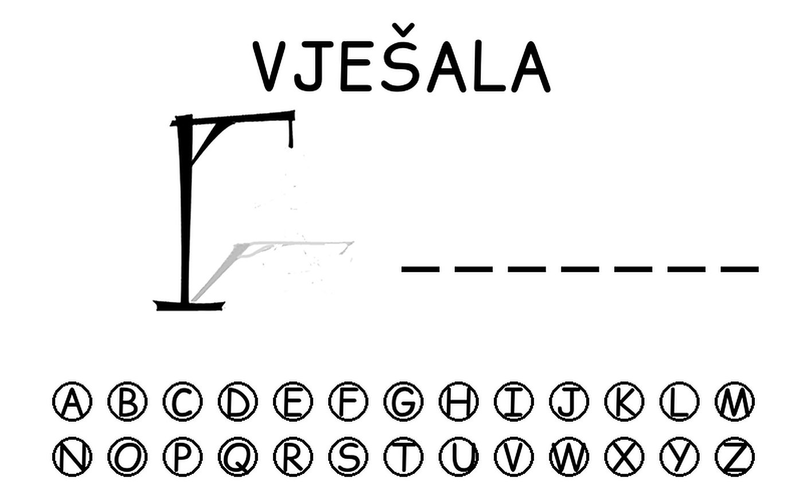
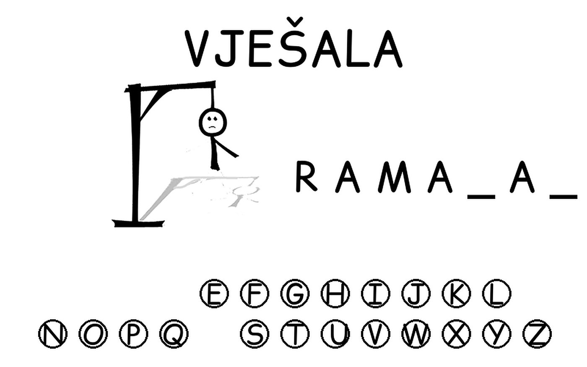
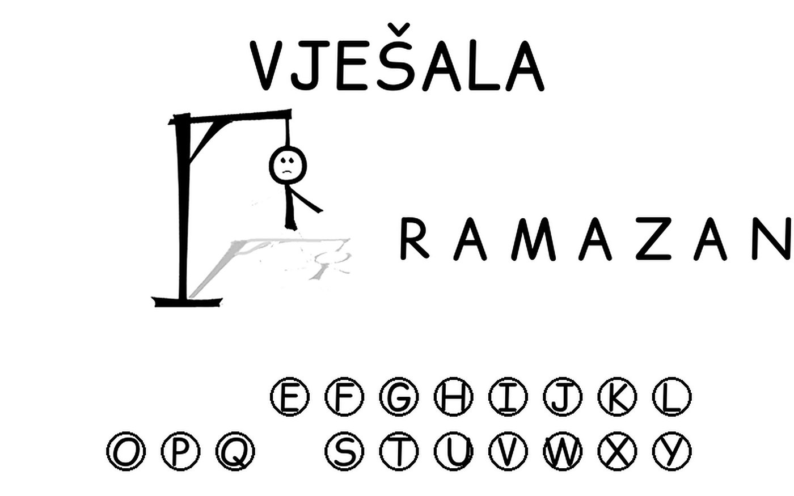

# Hangman

A hangman game with a Bosnian interface, played by clicking letters on the screen.





## Features

- 26 on-screen letter buttons; a click is detected from the distance to each circle
- Seven gallows images; six wrong guesses lose the game
- The word is picked at random from a list
- A 60 frames-per-second game loop with win and lose messages in Bosnian

## Tech

Python 3, [pygame](https://www.pygame.org/).

## Run

```bash
pip install pygame
cd Hangman
python main.py
```

Run it from inside the `Hangman` folder, because the gallows images are loaded by relative path.

## Author

Harun Kestendžić — [GitHub](https://github.com/harunkestendzic)
